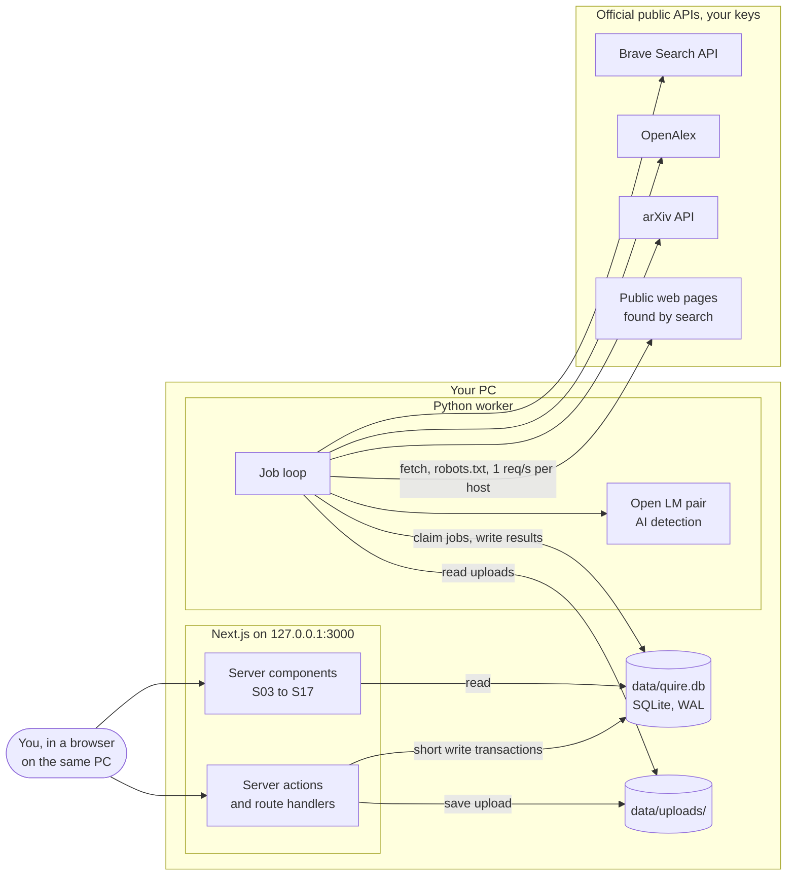
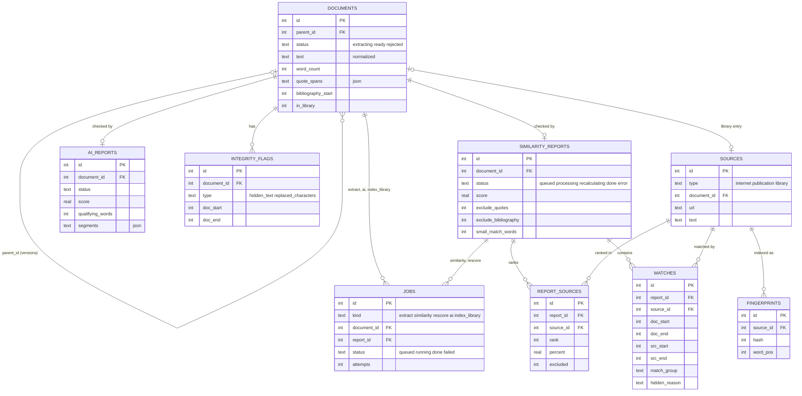
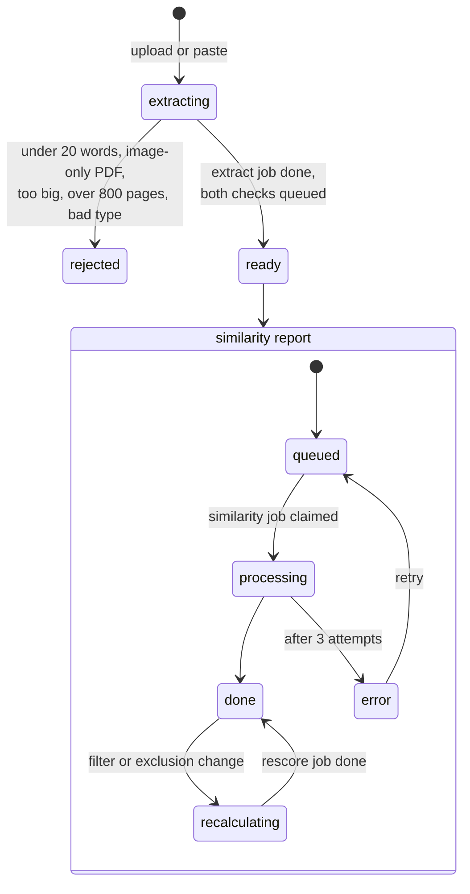
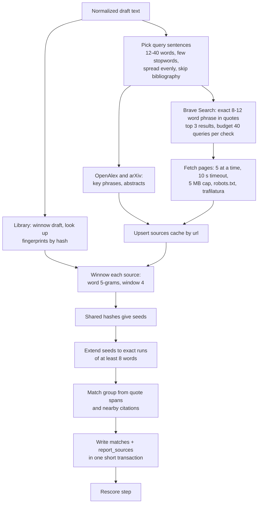
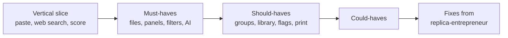

# Architecture: Quire (a rebuild of Turnitin's similarity and AI writing checks)

"Quire" is a working name. `/replica-brand` picks the real one.
Built from `recon.md` and `features.csv` (2026-10-28). Screen IDs (S..) and flow IDs (F..) refer to the recon map.

**Personal and local.** One owner, one machine. No accounts, no sign-in, no hosting: the web app listens on `127.0.0.1` only, and that is the access control. Putting it on a network or the internet would need auth added back first (the schema has no owner columns to lean on).

**Nothing is submitted to anyone,** so Turnitin's institution steps are dropped: no confirm screen before a check (S05) and no digital receipt (S06). A pasted or uploaded draft is checked as soon as its text is extracted, and the report (S07) shows that extracted text.

## Shape

One web app, one SQLite file, one worker, all on your PC. The web app never does heavy work: it writes rows and queues jobs. The worker does extraction, source search, alignment, scoring and AI detection, because all of that is slow, needs Python libraries, and needs a language model.

## Stack

| layer | choice | why |
| --- | --- | --- |
| web | Next.js 16 (App Router) + TypeScript, `next dev -H 127.0.0.1` / `next start -H 127.0.0.1` | server components read the database directly, server actions cover the writes; bound to loopback only |
| styling | Tailwind v4, tokens from `/replica-design` | already built in `web/` |
| mobile | none, responsive web | one user, desktop-first report (recon S07) |
| database | SQLite, one file `data/quire.db`, WAL mode | no server, no Docker, nothing to install; one user and one worker never need more |
| data access (web) | `node:sqlite` (built into Node 22.13+, here 22.14 with SQLite 3.47), raw SQL in `web/lib/db.ts` | no dependency; prints an ExperimentalWarning, fall back to `better-sqlite3` if it misbehaves under Next |
| data access (worker) | Python stdlib `sqlite3` (SQLite 3.45) | no dependency |
| migrations | `db/migrations/NNN_*.sql`, applied by `db/migrate.py` (stdlib) using `PRAGMA user_version` | one runner for both sides; the worker runs it at startup, the web app refuses to start on an old version |
| auth | none | personal and local; see "Personal and local" above |
| payments, email | none | nothing to pay for, nobody to email |
| jobs | `jobs` table + one Python worker | the queue lives in the same file and transactions |
| files | `data/uploads/{document_id}/{filename}` on disk | no storage service needed |
| hosting | none; both processes run on your PC | the worker needs a model and long runs anyway |
| worker libraries | `httpx2`, `pdfplumber`, `python-docx`, `striprtf`, `odfpy`, `trafilatura`, `confusable_homoglyphs`, `py3langid`, `transformers` + `torch` | one library per job; stdlib `sqlite3`, `difflib`, `urllib.robotparser`, `hashlib`, `unicodedata` for the rest |
| source search | Brave Search API (web), OpenAlex and arXiv (scholarly) | official APIs with your own key; Brave is the only paid one, check its current quota before choosing a per-check budget |

`data/` is git-ignored: it holds your drafts and fetched pages.

## Schema

Tables: 9. Access rules: none beyond the loopback bind. There are no users, so there are no owner columns, no row level security and no per-user checks.

Full SQL: [`schema.sql`](schema.sql) (SQLite dialect; it is `db/migrations/001_init.sql`). Checked by applying it to an in-memory database and exercising its constraints, cascades, the job-collapse index and the claim query.

Hard constraints the recon found, enforced in the database:

- **One report per draft.** `similarity_reports.document_id` and `ai_reports.document_id` are unique. A revised draft is a new `documents` row with `parent_id`, so history is kept (F08).
- **Double clicks and filter spam collapse.** Partial unique indexes allow one queued job per kind and target; writes use `ON CONFLICT DO NOTHING`.
- **Jobs point at a real row.** Each job has exactly one of `document_id` or `report_id`, matching its kind, as real foreign keys, so deleting a draft deletes its jobs.
- **States that must agree.** Check constraints: a rejected document has a reason, a done report has a score, an unavailable AI report has a reason, a library source has a document, JSON columns are valid JSON of the right shape.
- **Offsets are always valid spans** (`doc_end > doc_start`), and every offset points into the stored normalized text, never into the original file.
- **File size** is capped at 50 MB by a check constraint and again before the upload is written to disk.

Delete rules, decided:

| foreign key | on delete | why |
| --- | --- | --- |
| `documents.parent_id` | set null | deleting an old draft keeps the newer ones |
| reports, flags, jobs, library source to `documents` | cascade | a report means nothing without its draft |
| `report_sources`, `matches`, jobs to `similarity_reports` | cascade | same |
| `report_sources`, `matches`, `fingerprints` to `sources` | cascade | `deleteDocument` queues a rescore for every other report that lost matches this way |

These only work with `PRAGMA foreign_keys = ON` on every connection (SQLite's default is off).

## The worker pipelines

All the product's hard logic lives here, in one place, so the score is computed by exactly one piece of code.

### Job kinds

| kind | queued by | does | target |
| --- | --- | --- | --- |
| `extract` | `submitText`, upload route | read the file, extract text, normalize, find quotes and bibliography, record integrity flags, count words and pages; then `rejected`, or `ready` plus both reports and the `similarity` and `ai` jobs in the same transaction | document |
| `similarity` | `extract`, `retryReport` | find candidate sources, fetch them, align, then run the rescore step | report |
| `rescore` | `requestRescore`, `deleteDocument` | apply filters and exclusions, rank sources, write score; no network | report |
| `ai` | `extract` | prose filter, detector over sentence windows, segments and score | document |
| `index_library` | `setInLibrary(on)` | create or reuse the library `sources` row, write fingerprints | document |

Claiming: `BEGIN IMMEDIATE`, then one `UPDATE ... RETURNING` (in `schema.sql`). With a single worker, jobs run one at a time, so a rescore can never overlap the similarity pass for the same report.

Failures: a job that throws is marked `failed` with its error, and its report `error`; `retryReport` (or pasting again) runs it again. No automatic retries or backoff, since you are watching. At startup the worker puts any `running` job back to `queued`: with one worker, it can only be left over from a crash.

Housekeeping, every hour inside the worker loop: delete `done` jobs older than 7 days, delete cached internet and publication sources older than 30 days that no report references, delete `data/uploads/` folders with no `documents` row.

### Extraction (`extract`)

1. Read the file by type: `.docx` python-docx (paragraphs and runs), `.pdf` pdfplumber (characters with colors), `.rtf` striprtf, `.odt` odfpy, `.txt` UTF-8 then cp1252. Anything else is `unsupported_type`. A PDF with pages but no characters is `image_only_pdf`.
2. Hidden text: a DOCX run that is white, under 2 pt, or has `w:vanish`, or a PDF character filled white, becomes a `hidden_text` flag. The text stays in the document, as in Turnitin.
3. Normalize: Unicode NFKC, strip zero-width characters, replace Cyrillic or Greek lookalikes inside Latin words with the Latin letter (one `replaced_characters` flag per run). Matching and every offset use this text.
4. Quote spans: pairs of straight or curly double quotes, up to 1,200 characters. Bibliography: the last line in the final 40% of the text that is only "References", "Bibliography", "Works cited", "Sources" or "Literature cited".
5. Words: `\w+` tokens with character offsets. Under 20 words is `too_few_words`. Language by `py3langid`.

### Similarity (`similarity`)

Winnowing with word 5-grams and a window of 4 guarantees that every shared run of 8 or more words is found (k + w - 1 = 8), which lines up with Turnitin's 8-word small-match default. All network work happens before the write transaction opens, so the web app is never blocked waiting on a fetch.

Match groups (S09), per match:

| in a quote span | citation in the same or next sentence | group |
| --- | --- | --- |
| yes | yes | `cited_and_quoted` |
| yes | no | `missing_citation` |
| no | yes | `missing_quotation` |
| no | no | `not_cited_or_quoted` |

A citation is `(Name ..., 2020)`, `(Name 2020, p. 4)` or `[12]` / `[3, 4-6]`. Footnote markers are lost in extraction, so footnote-style citations count as missing (a known gap).

### Rescore (scoring rule)

Runs at the end of every `similarity` job and alone after every filter change. No network, so it takes well under a second.

1. Hide matches by filter, in this order, writing `hidden_reason`: `match_excluded`, `source_excluded`, `own_version` (source is any document in this draft's `parent_id` chain), `source_type`, `quote`, `bibliography`.
2. For each source, count the words its visible matches cover. Under `small_match_words`, or under `small_match_percent` of the draft, hides the whole source as `small_source`.
3. Rank greedily: the source covering the most not-yet-claimed words gets the next rank and claims them. Ties go to more total words, then source id. A source left with 0 claimed words gets no rank and 0%.
4. `percent` = claimed words / draft word count. `score` = all claimed words / draft word count. The denominator never shrinks when filters hide text.

This one-word-one-source rule is why excluding the top source can barely move the score (recon F04 edge). It needs one runnable check: `worker/score_test.py` with overlapping sources, a small source and a quoted match.

### AI writing (`ai`)

1. Prose only: sentences of at least 6 words ending in `.`, `?` or `!`, not list items, not after `bibliography_start`. Under 300 qualifying words gives `unavailable / too_few_words`. Non-English gives `unavailable / unsupported_language`.
2. Group sentences into windows of about 150-250 tokens.
3. Binoculars score per window (Hans et al., 2024): log-perplexity under the observer model divided by cross-perplexity between the observer and performer models. Low means machine-like. About 30 lines with `transformers`. The model pair is an environment setting: a small base/instruct pair for CPU, a 7B pair on a GPU.
4. A window under the threshold becomes an `ai` segment. Score = words in `ai` segments / qualifying words. The UI shows `*` and no highlights when 0 < score < 20, as Turnitin does.
5. Calibrate the threshold once on 20 or more of your own essays written before 2022: set it so none of them flags. The threshold version goes in `ai_reports.model`.
6. `ai_paraphrased` (purple) stays in the schema but nothing emits it until a paraphrase classifier exists. No open model does this reliably today.

## API

Pages are server components that read SQLite through `web/lib/db.ts`; each read calls `await connection()` first and sits behind `<Suspense>`, so it happens per request rather than at build time. Writes are server actions, except file transfer and the status poll, which are route handlers. Inputs get plain checks in the action (lengths, types, ids), backed by the schema's CHECK constraints; no validation library. There is no session: everything on `127.0.0.1:3000` is yours.

| method path | does | input | output | flow |
| --- | --- | --- | --- | --- |
| GET `/` | S03: drafts with similarity and AI badges, processing state, "waiting for worker" when a queued job is over 60 s old | `?q` | page | F01 F05 F08 |
| GET `/submit` | S04: dropzone and paste box | `?parent` | page | F01 F08 |
| POST `/api/upload` | check type, size and name; insert `documents` (`extracting`); write `data/uploads/{id}/`; queue `extract` | multipart `{file, title, parentId?, inLibrary?}` | `{documentId}` | F01 F08 F09 |
| action `submitText` | insert `documents` with the pasted text, queue `extract` | `{title, text (max 2 MB), parentId?}` | redirect | F01 F08 |
| GET `/api/status` | statuses for the S03 poll (every 3 s while anything is unfinished) | `?ids=1,2,3` | `[{id, document, similarity, ai, queuedFor}]` | F01 |
| action `deleteDocument` | delete with cascades, rescore affected reports, remove its upload folder | `{documentId}` | `{ok}` | F01 F09 |
| GET `/reports/[id]` | S07 viewer; `?panel=sources\|groups\|flags\|filters\|excluded` opens S08, S09, S13, S11, S12; `?match=` opens S10 | query params | page | F02 F03 F04 F06 F07 |
| action `updateReportSettings` | write filter columns, `requestRescore` | `{reportId, excludeQuotes, excludeBibliography, smallMatchWords, smallMatchPercent, sourceTypes, excludeOwnVersions}` | `{ok}` | F03 |
| action `setSourceExcluded` | set `report_sources.excluded`, `requestRescore` | `{reportId, sourceId, excluded}` | `{ok}` | F04 |
| action `setMatchExcluded` | set `matches.excluded`, `requestRescore` | `{matchId, excluded}` | `{ok}` | F02 |
| action `retryReport` | failed report back to queued | `{reportId}` | `{ok}` | F01 |
| GET `/documents/[id]/ai` | S14 AI viewer with segments, legend and disclaimer | | page | F05 |
| GET `/api/documents/[id]/file` | stream the original upload | | file | F07 |
| GET `/library` | S17: library documents and dropzone | | page | F09 |
| action `setInLibrary` | add to or remove from the library | `{documentId, inLibrary}` | `{ok}` | F09 |

15 routes: 5 pages, 3 route handlers, 7 server actions. S01 (sign in), S05 (confirm) and S06 (receipt) are gone. S15 "current view PDF" is the browser's print dialog with a print stylesheet, not a route.

Webhooks in or out: none.
Outbound calls, all from the worker with your own keys: Brave Search API, OpenAlex (polite pool, `mailto` from env), arXiv API, plain GETs of public pages that search returned. Never any Turnitin endpoint.

## The parts that bite

- **Loopback is the only lock.** Both `next dev` and `next start` get `-H 127.0.0.1`. Binding is not enough on its own: a web page you visit could use DNS rebinding to reach `127.0.0.1:3000` under its own hostname. `web/proxy.ts` answers 403 to any request whose `Host` is not `localhost:3000`, `127.0.0.1:3000` or `[::1]:3000`. Next's built-in server action origin check covers cross-site form posts.
- **Foreign keys are off by default in SQLite.** Every connection, in both languages, runs `PRAGMA foreign_keys = ON; journal_mode = WAL; busy_timeout = 5000` first, through one helper per side. Without it, deletes leave orphans silently.
- **One writer at a time.** SQLite serializes writes. The worker never holds a transaction across network calls: fetch and align first, then one short `BEGIN IMMEDIATE` to write. Web writes are single short transactions. `busy_timeout` covers the brief waits.
- **Times as text.** Times are written only by SQL `strftime('%Y-%m-%dT%H:%M:%fZ','now')`, so text comparison equals time comparison. Python or JavaScript `Date` strings in a different format would break `run_after <= now`.
- **`node:sqlite` is marked experimental** in Node 22. It prints a warning and its API could change on a Node upgrade. If it breaks under Next's bundler, `better-sqlite3` is a drop-in for the same raw SQL.
- **Search cost and recall:** every check spends search API queries. Cap it per check (`SEARCH_QUERY_BUDGET`, default 40, logged in `queries_used`), cache fetched sources for 30 days, and expect to miss anything that is not indexed publicly, above all other students' papers.
- **Rate limits:** Brave's per-second and monthly quota, OpenAlex's polite pool, arXiv's request spacing, and site owners. One request per second per host, respect `robots.txt`, back off on 429 with `run_after`.
- **Idempotency:** a job can run twice (worker crash, requeue). Each job deletes its own previous output for the target inside the same transaction before writing, so a rerun replaces rather than duplicates.
- **File size:** 50 MB per upload, checked in the browser, in the upload route before writing, and by the schema. Pasted text is capped at 2 MB, which needs `experimental.serverActions.bodySizeLimit: '3mb'` (the default is 1 MB).
- **Offsets:** normalization shifts characters, so the viewer shows the stored normalized text, not the original layout. Highlights can never drift, at the cost of losing page layout (a known ceiling; Turnitin renders pages).
- **Extraction quality:** two-column PDFs, headers, footers and hyphenation produce broken sentences and false matches. Strip repeated header and footer lines and rejoin hyphenated line breaks.
- **AI false positives:** the detector is not Turnitin's and will flag some human writing. Calibrate on your own essays, show the disclaimer on S14, and never treat the number as proof.
- **The worker must be running:** if it is stopped, jobs wait. S03 says "waiting for worker" when a queued job is older than 60 seconds.
- **No caching of reads:** the worker changes data outside Next, so no `use cache` on anything that reads the database. With `cacheComponents` on, database reads sit behind `<Suspense>`.
- **Backups:** your drafts live in `data/`. Copy `quire.db` (with the worker stopped, or with `sqlite3 .backup`) and `uploads/` if they matter.
- **Copyright:** fetched pages are cached for personal comparison only. Nothing from them is published, and the app never uses Turnitin's name, logo or wording.

## Build order

1. **Vertical slice** (ugly, end to end): paste text, see a score with highlighted matches.
   - Screens: S03, S04 (paste only), S07 (highlights and score only).
   - Tables: all nine from `001_init.sql` (unused ones cost nothing). Code: `db/migrate.py`, `web/lib/db.ts` with `submitText`, `web/proxy.ts` host check.
   - Routes: `/`, `/submit`, `submitText`, `/reports/[id]`.
   - Worker: claim loop, `extract` (pasted text) queuing the checks, `similarity` with Brave only, rescore with no filters, `score_test.py`.
   - Proves: both languages share one database safely, the queue, the cost of one check, and that alignment finds a pasted Wikipedia paragraph.
2. **Must-haves** (16 rows in `features.csv`), by area:
   - submit: file upload, the five formats, the rejection rules. `/api/upload`, `deleteDocument`.
   - submissions: processing states, `/api/status` polling and the "waiting for worker" hint on S03, `retryReport`.
   - report: S08 ranked sources, S10 side by side.
   - filters: S11 quotes, bibliography, small matches in words; S12 exclude and restore; `rescore` job, `updateReportSettings`, `setSourceExcluded`, `setMatchExcluded`.
   - ai: the `ai` job, S14 with the 300-word, `*` and prose-only rules, `/documents/[id]/ai`, a calibration script.
3. **Should-haves** (11): S09 match groups; OpenAlex and arXiv; S17 library with `fingerprints`, `index_library`, `setInLibrary`; S13 flags; source-type filter; S15 print stylesheet; versions with `parent_id` and own-version exclusion; similarity color bands. The purple AI-paraphrased label waits for a classifier.
   Then **could-haves** (9): small matches by percent, translated matching, cloud pickers, version score comparison, mobile bottom sheet, a Word or Google Docs add-in, `/api/documents/[id]/file`, a delete button on S03, non-English AI detection.
4. **Fixes from replica-entrepreneur**, once it has run.
