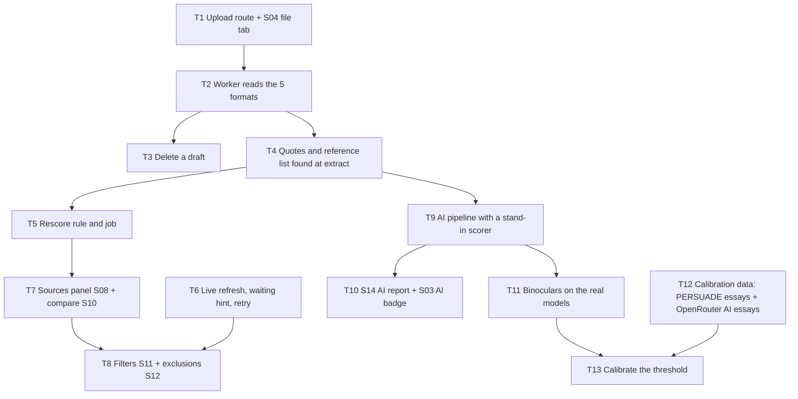

# Implementation Plan: Milestone 2, the must-haves

Spec: `replica/architecture.md` (Build order item 2, pipelines, parts that bite), `replica/features.csv`, `replica/recon.md`, `replica/schema.sql`. Milestone 1's plan and findings are in `tasks/m1/`.
Task checklist: `tasks/todo.md` (same IDs). Planned 2026-10-29. Built in the main session, no subagents; each phase is its own commit.

## Overview

Milestone 1 proved the loop: paste, search, score, highlight. Milestone 2 makes it the tool you would actually use on an essay: upload the file instead of pasting, watch the check progress without reloading, see which sources matched and compare passages side by side, leave out quotes, the reference list and tiny matches, exclude a source, and get an AI-writing estimate. It closes the 12 remaining `must` rows in `features.csv`.

Out of M2 (should and could, M3+): match groups (S09), integrity flags (S13), OpenAlex/arXiv, the library (S17), source-type filter, versions, print/PDF, small matches by percent, the purple AI-paraphrased label.

## Must rows covered

| Feature row | Tasks |
| --- | --- |
| Upload a file (docx pdf txt rtf odt) | T1, T2 |
| Reject invalid files (< 20 words / image-only PDF / too big / unsupported type) | T1, T2 |
| Processing status while a report builds | T6 |
| Ranked sources list with % per source | T7 |
| Side-by-side match comparison with source link | T7 |
| Filter: exclude quotes | T4, T5, T8 |
| Filter: exclude bibliography | T4, T5, T8 |
| Filter: exclude small matches under N words | T5, T8 |
| Exclude a source and restore it | T5, T8 |
| AI writing score with highlighted segments | T9, T10, T11 (calibrated in T12, T13) |
| AI score guardrails (300-word minimum / * under 20% / prose only) | T9, T10 |
| Submissions list with similarity and AI scores | T10 |

## Dependency graph

T6 touches only the web app and can go anywhere before T8. T9 and T10 need no model, so the UI is proven before the multi-GB download in T11. T12 needs no model either and can run any time after T2.

## Architecture decisions

### 1. Uploads (T1, T2)
- `POST /api/upload`, a route handler (not a server action), taking multipart form data. It checks, in order:
  1. The **`Origin` header** is `http://127.0.0.1:3000` or `http://localhost:3000`.
     - Server actions get Next's origin check, but route handlers don't.
     - A web page you visit could otherwise post a file to your local app and spend your Brave quota.
     - The Host check in `proxy.ts` doesn't catch this, because a cross-site form post still carries `Host: 127.0.0.1:3000`.
  2. The **extension** is one of the five.
  3. The **size** is 50 MB or less: refused from `Content-Length` before reading, and again as bytes are written.
  4. The **title** is 1 to 300 characters.
- Files are saved as `data/uploads/{document_id}/original{.ext}`. The original filename is kept only in `documents.filename`, so nothing you upload can shape a path on disk. The folder is created inside a transaction-backed insert: if writing fails, the row is deleted.
- One validation module, `web/lib/upload.ts`, is used both by the dropzone (instant feedback) and the route (the real check). It replaces `checkFile` in `dropzone.tsx`.
- Worker side, `worker/extract.py` reads each format:

  | Format | Library | Notes |
  | --- | --- | --- |
  | `.docx` | `python-docx` | paragraph text |
  | `.pdf` | `pdfplumber` | pages joined; a PDF with pages but no characters is `image_only_pdf`; over 800 pages is `too_many_pages` |
  | `.rtf` | `striprtf` | |
  | `.odt` | `odfpy` | |
  | `.txt` | none | UTF-8, falling back to cp1252 |

  - DOCX and ODT are zip files: refused as `extraction_failed` if their uncompressed size is over 200 MB (zip bomb).
  - Every parser failure becomes `rejected / extraction_failed` with the message in the job's error. Nothing is ever left stuck at "extracting".
  - The extracted text then goes through the existing `normalize`, word count, and the queueing of both checks, so pastes and uploads share one path.

### 2. Live status (T6)
- **No `/api/status` route** (a change from the architecture). A tiny client component, `<AutoRefresh active />`, calls `router.refresh()` every 3 seconds while anything on the page is unfinished. Pages already read the database per request, so a refresh re-renders them with fresh data. One fewer route, and nothing to keep in sync.
- **"Waiting for worker":** `listDrafts` also returns whether the draft has a queued job older than 60 seconds. S03 then shows the warning pill with the command to start the worker.
- **`retryReport`** (server action): a failed similarity report goes back to `queued` with a new job. It's offered on S07's failed state and in the S03 row menu.

### 3. One scoring path: rescore (T4, T5)
- At extract, `text.py` finds:
  - **Quote spans:** pairs of straight `"` or curly double quotes, up to 1,200 characters. Single quotes are ignored, since they are mostly apostrophes.
  - **Where the reference list starts:** the last line in the final 40% of the text that reads only "References", "Bibliography", "Works cited", "Sources" or "Literature cited".

  These are stored in `documents.quote_spans` and `bibliography_start`. M1 drafts keep `[]` and null, which simply means no quotes or reference list.
- At similarity, each match gets two flags:
  - `in_quote`: at least half of its characters are inside a quote span.
  - `in_bibliography`: it starts at or after `bibliography_start`.
- **`worker/rescore.py`** applies the architecture's rule:
  1. Hide matches, writing `hidden_reason` in this order: `match_excluded`, `source_excluded`, `quote` (if the filter is on), `bibliography` (if the filter is on).
  2. Hide a whole source as `small_source` when its visible matches cover fewer than `small_match_words` words.
  3. Rank and score with the existing `score.py`.
  4. Write ranks, percents, `hidden_reason`, the score, and set the report to `done`.

  Word ranges are recomputed from the stored character offsets with `words()` and a bisect, so no schema change is needed.
- **The similarity job now ends by calling the same `rescore`** inside its write transaction, so there is exactly one piece of scoring code.
- The `rescore` job kind gets a handler. It runs in well under a second and never touches the network.
- `own_version` and `source_type` stay unused until M3 (versions and the source-type filter are should-haves).

### 4. Report UI (T7, T8)
- `getReport` grows to return:
  - the ranked sources: rank, percent, matched words, title, URL, type, excluded;
  - every match with its source passage (a slice of `sources.text`, with a little context on each side);
  - the report's filter settings.
- S07 becomes one client component, `ReportView`. It's fed by the server page and holds the selected match and panel tab, mirrored in the URL (`?panel=`, `?match=`) as the spec says.
  - It reuses the design primitives: `DocumentViewer` (with `onSelect`), `PanelTabs`, `SourceCard`, `SplitCompare`, `Switch` and `TextField`.
  - Tabs in M2: **Sources** (S08, with an Excluded section at the bottom, which is S12) and **Filters** (S11). Groups and Flags are M3.
- **Server actions,** each writing its change and calling `requestRescore` in one `db.ts` transaction:
  - `updateReportSettings`: quotes, bibliography, small-match words.
  - `setSourceExcluded`.
  - `setMatchExcluded`.

  `requestRescore` sets the report to `recalculating` and queues a `rescore` job, collapsing repeats. S07 then shows the recalculating badge and refreshes until `done`.

### 5. AI writing (T9 to T12)
- **`worker/ai.py`, the pipeline:**
  - **Prose only:** sentences of at least 6 words ending in `.`, `?` or `!`, not list lines, and not after `bibliography_start`.
  - **Guards:**
    - Under 300 qualifying words gives `unavailable / too_few_words`.
    - Not English (`py3langid`) gives `unavailable / unsupported_language`.
  - **Windows:** consecutive sentences of about 120 to 200 words each.
  - **Scoring:** a window scoring under the threshold becomes an `ai` segment. The score is words in `ai` segments divided by qualifying words.
  - **The scorer is a plain function argument,** so T9 and T10 are tested with a stand-in and need no model.
- **The `ai` job handler only joins `HANDLERS` in T11,** once a real scorer exists. Until then `ai` jobs keep waiting, as they do now. When an `ai` job fails, `mark_failed` now also marks its `ai_reports` row `error`.
- **S14 at `/documents/[id]/ai`:**
  - the draft with `ai` segments highlighted, and a legend;
  - the disclaimer: "an estimate from an open model, wrong in both directions, not proof";
  - when 0 < score < 20%: `*` and no highlights;
  - a reason when unavailable;
  - an "uncalibrated" notice until T12 has set a threshold.

  S03's AI badge shows the real state and links to S14.
- **The Binoculars scorer** (Hans et al., 2024), in `worker/binoculars.py`:
  - **What it computes:** log-perplexity under the performer model divided by cross-perplexity between the observer and performer models. Low means machine-like.
  - **Models:** set by environment variables `AI_OBSERVER` and `AI_PERFORMER`, a base and instruct pair sharing one tokenizer.
  - **Device:** `AI_DEVICE` picks it, defaulting to CUDA if available, otherwise CPU.
  - **Loading:** lazily, once per worker run.
  - **`ai_reports.model`** records the pair, the threshold, and whether it is calibrated.
- **Hardware and models (decided 2026-10-29):** local GPU.
  - The machine has an RTX 4060 Laptop with 8 GB of video memory, an i9-14900HX, 32 GB RAM, and 82 GB free on C:.
  - The pair is `Qwen/Qwen2.5-1.5B` (observer) and `Qwen/Qwen2.5-1.5B-Instruct` (performer): about 6 GB of model files from Hugging Face, plus CUDA `torch` at about 2.5 GB, using about 6 GB of the 8 GB of video memory.
  - The paper's Falcon-7B pair needs about 28 GB at fp16, so it doesn't fit.
  - **Your drafts never leave the PC.**
- **Why not OpenRouter for the score:** Binoculars needs both models' probability for every token of *your* text. OpenRouter's chat API returns probabilities only for tokens it generates, and nothing shows it can score submitted text. Asking a model "was this AI-written?" is far less reliable, and on free models it would send drafts to providers that may log them. So OpenRouter only writes the AI comparison essays below.
- **Calibration data (T12), because you have no essays of your own:**
  - **Human side: PERSUADE 2.0.** About 26,000 argumentative essays by US students in grades 6 to 12, over 15 prompts, published by Crossley et al. under CC BY 4.0.
    - It formed the core of a Kaggle competition in winter 2021-22, so it predates ChatGPT.
    - `worker/calibration/persuade.py` downloads the authors' training CSV once (Google Drive, roughly 60 to 80 MB) into `data/calibration/`, which is git-ignored.
    - It then samples a few hundred essays spread across the prompts, each with at least 300 words of prose. The sample uses a fixed seed, so reruns pick the same essays.
  - **AI side: written by free OpenRouter models.** `worker/calibration/generate_ai.py` asks two or three different free models to write student-style essays on the same 15 prompts, a few per prompt, and saves them as `.txt` in `data/calibration/ai/`.
    - It paces itself to the free limits (20 requests a minute, 50 a day without credits) and resumes where it stopped.
    - It sends only those essay prompts, never your drafts.
    - It needs an OpenRouter key in `worker/.env` (U1).
  - **Any other folder works too.** The calibration script takes a folder of `.txt`, `.docx`, `.pdf`, `.rtf` or `.odt` files on either side, read by T2's `extract.py`. So essays collected later as PDFs, or your own future writing, can be added.
- **Calibration (T13), `worker/calibrate_ai.py`:**
  - It scores every window of both sets with the real models.
  - It sets `AI_THRESHOLD` so that at most 1% of the human essays' windows fall under it. A strict "none of them" stops being meaningful with hundreds of essays, because one odd essay would set the bar.
  - It reports how many AI windows and whole AI essays the threshold catches, and how many human essays would get an AI score of 20% or more.
  - It writes the numbers to `data/calibration/report.md` and prints the `AI_THRESHOLD=` line for `worker/.env`.
  - S14's notice then reads "calibrated on PERSUADE 2.0 student essays" with the false-positive rate, instead of "uncalibrated".
- **New pinned worker dependencies:**
  - `pdfplumber`, `python-docx`, `striprtf`, `odfpy` (T2).
  - `py3langid` (T9).
  - `torch` (CUDA build) and `transformers` (T11).
  - No new ones for OpenRouter or Google Drive, which use the existing `httpx`.
  - The web app gets none.

### 6. How work is verified
- **Web,** every task, from `web/`: `npx tsc --noEmit` (after `npm run build` when routes change, so route types exist), `npx eslint`, `npm test`, `npm run build`.
- **Worker:** `.venv\Scripts\python -m unittest discover -p "*_test.py"` from `worker/`.
- **Test fixtures are generated in the tests, not downloaded:**
  - DOCX and ODT are built with their own libraries.
  - RTF and TXT are written as strings.
  - PDFs come from a tiny hand-written PDF writer: one with a text layer, one image-only.
- **Browser checks** of S03, S04, S07 and S14 at 375 px and 1280 px, plus keyboard focus, as in M1.
- **No automated test spends Brave quota, calls OpenRouter, downloads data or loads a model.** The OpenRouter and Drive clients are tested with `httpx.MockTransport`, and the calibration maths with a tiny CSV and a stand-in scorer. T11 has one opt-in smoke test (`AI_SMOKE=1`). One manual end-to-end check at the final checkpoint spends about 5 to 10 Brave queries and runs the real model.

## Phases and tasks

| ID | Task | Depends on | Size |
| --- | --- | --- | --- |
| T1 | Upload: `web/lib/upload.ts` checks, `POST /api/upload` (Origin, type, size, safe path), S04 file tab | None | M |
| T2 | Worker reads `.docx .pdf .rtf .odt .txt`; rejections for image-only PDF, page limit, zip bomb, parser errors | T1 | M |
| T3 | Delete a draft: S03 row menu, confirm dialog, `deleteDocument` removes the row (cascades) and its upload folder | T2 | S |
| CP1 | Upload each format, see bad files refused, delete a draft; commit Phase 1 | | |
| T4 | Quotes and reference list found at extract; matches flagged `in_quote` / `in_bibliography` | T2 | S |
| T5 | `rescore.py` (hide by filter, small sources, rank, score), the `rescore` job, similarity ends with it | T4 | M |
| CP2 | All scoring goes through one path; filter rules proven in tests; commit Phase 2 | | |
| T6 | `<AutoRefresh>`, waiting-for-worker pill, `retryReport` | None | S |
| T7 | S07 `ReportView`: Sources panel (S08) and side-by-side compare (S10), URL state | T5 | M |
| T8 | Filters panel (S11), exclude and restore sources (S12) and matches, `requestRescore`, recalculating state | T6, T7 | M |
| CP3 | A real report filtered and exclusions applied in the browser; commit Phase 3 | | |
| T9 | `ai.py` pipeline (prose filter, language, windows, segments, score) and job, tested with a stand-in scorer | T4 | M |
| T10 | S14 AI report page and S03 AI badge, shown with stand-in results | T9 | M |
| T11 | `binoculars.py` on the Qwen2.5-1.5B pair on the GPU, `ai` handler on, speed measured | T9 | M |
| U1 | You create a free OpenRouter key and put it in `worker/.env` | | |
| T12 | Calibration data: PERSUADE 2.0 download and sample; AI essays from free OpenRouter models | T2, U1 | M |
| T13 | `calibrate_ai.py`: threshold at 1% human false positives, report, S14 notice | T11, T12 | S |
| CP4 | Final end-to-end run (upload, check, filters, AI); features rows; review; commit Phase 4 | | |

## Your steps

| ID | Step | Blocks |
| --- | --- | --- |
| U1 | Create a free account at openrouter.ai, make an API key, and put it in `worker/.env` as `OPENROUTER_API_KEY`. | T12's AI essays only |
| U2 | Watch the final end-to-end check (about 5 to 10 Brave queries). | CP4 |

## Decided defaults

- Upload limit stays 50 MB; uploads and pastes share one extract path.
- Status updates by refreshing the page every 3 seconds while something is unfinished; no status API.
- Small-match words default to 0 (off) on each report; you set it in Filters.
- Quotes are double quotes only; single quotes are treated as apostrophes.
- S12 (excluded sources) is a section at the bottom of the Sources tab, not a separate tab.
- The `ai` job is claimed only from T11 on; until then AI badges stay `--`.
- The AI threshold allows at most 1% of human windows to fall under it (T13).
- Calibration data, downloaded or generated, lives in `data/calibration/` and is never committed. PERSUADE 2.0 is credited in `data/calibration/report.md` and on S14.

## Risks and mitigations

| Risk | Impact | Mitigation |
| --- | --- | --- |
| A web page you visit posts a file to `/api/upload` (cross-site request), spending Brave quota | High | `Origin` check in the route handler, covered by a test; server actions already have Next's check. |
| An upload's filename shapes a path on disk (path traversal) | High | Files are saved as `original{.ext}` under a folder named by the integer id; the name only lives in the database. Tested with `../` names. |
| A malformed or hostile DOCX, ODT or PDF hangs or exhausts the worker | Med | Uncompressed-size cap for zip formats, 800-page cap, every parser error turns into a rejection. These are your own files, so the realistic risk is a broken export, not an attack. |
| CUDA `torch` on Windows is a large, fussy install | Med | T11 checks `torch.cuda.is_available()` first, falls back to CPU, and records which device ran. Q1 offers a CPU-only setup. |
| Binoculars with a small model pair is less accurate than the paper's | High | Calibrate against real student essays and model-written ones (T12, T13), report the measured rates, show the disclaimer, and never present the number as proof. |
| The calibration essays are US school students, not you | Med | The report says so; the false-positive rate is for writing like theirs. Any folder of your own writing can be added later and the threshold recomputed. Detectors are also known to flag non-native English writing more often; the S14 disclaimer says so. |
| The Google Drive link changes, or needs a confirmation step for large files | Low | `persuade.py` handles Drive's confirmation page and checks it got a CSV with the expected columns; otherwise it stops and points to the README's link. |
| Free OpenRouter models are rate-limited and rotate out | Low | Paced to 20 a minute, resumable, and two or three models so one disappearing doesn't stop it. About 45 essays fits the 50-a-day free limit. |
| An AI job blocks the one-worker queue | Low | Similarity is queued before AI for each draft; GPU scoring is expected to take seconds; T11 records real timings. |
| `router.refresh()` every 3 s is wasteful on a big report | Low | Only while something is unfinished; it stops once everything is done. |
| PDF layout (two columns, headers, hyphenation) breaks sentences and adds false matches | Med | Accepted for M2; the architecture's header and hyphen clean-up is noted as a follow-up if real PDFs show it. |

## Open questions

- **Q1, decided 2026-10-29:** local GPU detector with the Qwen2.5-1.5B pair; OpenRouter only for the AI comparison essays.
- **Q2, decided 2026-10-29:** no essays of your own, so the human set is PERSUADE 2.0 (CC BY 4.0), downloaded in T12.
- **Q3, at CP1:** for a realistic PDF check, download a few openly licensed PDFs from the web (for example CC BY arXiv papers, which are two-column)? I will name each file, its source and size before downloading. They would stay in git-ignored `data/samples/`.

## Found while building

- **T1:** `proxy.ts` runs on every path, and Next buffers request bodies for it only up to 10 MB by default (`experimental.proxyClientMaxBodySize`), silently cutting off the rest. Without raising it to 52 MB, any upload over 10 MB would have reached the route truncated. Checked with a 12.4 MB upload that arrived byte for byte.
- **T1:** the route answers 403 to a foreign or missing `Origin`, 413 from `Content-Length` before reading a 53 MB body, and 400 with the message for a bad type; all checked with curl.
- **T1:** files are saved as `uploads/{id}/original{.ext}` next to the database, and the path is stored relative to that folder so web and worker resolve it the same way (`data_dir` in the worker reads the database's own path, so tests with temp databases work too).
- **T2:** the five readers are pinned (`pdfplumber 0.11.10`, `python-docx 1.2.0`, `striprtf 0.0.35`, `odfpy 1.4.1`). The same text in DOCX, ODT, RTF and PDF extracts to the same 65 words. A rejection's parser detail is kept in the job's `error`.
- **CP1:** the in-app browser pane stops drawing frames while the Claude window is not on screen, so React never reveals streamed content there and nothing hydrates. Click-through checks that need hydration run in the headless Playwright browser instead; its snapshot folder `.playwright-mcp/` is git-ignored.
- **T4:** a straight `"` opens a quote after a space, bracket or dash and closes it anywhere else, so a quote left open is dropped at the next opener instead of swallowing the text up to it. A quote may run over a single line break (PDF lines wrap) but never over a blank line.
- **T5:** `report_sources.matched_words` is now the words a source matched at all, whatever the filters, so S08 can still show the size of an excluded or hidden source. Ranks and percents are the filtered ones. A similarity rerun (only a retry after an error) starts the source list fresh, so it forgets exclusions.
- **CP2:** on the real "Chain of custody" report the rescore job gave the same 100% the similarity job did; excluding the top source gave 13.43% (the second source's 18 of 134 words) and restoring it gave 100% again. No search quota spent.
- **T6:** "Waiting for worker" and S03's auto-refresh ignore the `ai` job until Phase 4, since nothing claims it yet and every draft would otherwise wait forever. T10 adds it back.
- **T7:** the comparison opens in the side panel, and while it is open the panel takes half the width, so your passage and the source's sit side by side (a container query at 448 px, so it also works below `lg`, where the panel sits under the paper). At 400 px the two columns were too narrow to read.
- **T7, known ceiling:** the worker's offsets count code points, but the paper slices the draft in JavaScript, which counts UTF-16 units, so in a draft with emoji or other characters outside the BMP the highlights after them would shift. Source passages are cut in SQLite, which counts like Python, so they are right. Convert the offsets in `getReport` if it ever matters.
- **CP3, checked and not a bug:** printing cached text in the Windows console showed `�` for curly quotes, which looked like a charset bug in the fetcher. The cached everlaw.com text has real U+201C and U+201D quotes and no U+FFFD; the page is valid UTF-8 and trafilatura reads it correctly. Count code points when checking text, not what the console prints.
- **T9:** windows are cut by splitting the prose into `round(words / 160)` parts and cutting before the sentence whose middle passes each boundary, so they come out even (840 words gives five of 168) instead of greedy windows with a stub left at the end. A sentence over 200 words stays a window of its own. Sentences are found line by line, so a heading or a PDF line with no closing punctuation never runs into the next line; abbreviations such as "e.g." end a sentence early, which only drops a short fragment.
- **T10:** `ai_reports.model` is JSON written by the worker (`detector`, `observer`, `performer`, `threshold`, `calibrated`, `falsePositiveRate`); S14 treats anything else as uncalibrated. The S03 badge and S14 were checked in every state (done 40%, done under 20% as `*` with no highlights, 0%, both unavailable reasons, failed, queued, unknown id) at 375 and 1280 px with stand-in results from the real pipeline. The `ai` kinds move into the "waiting" check in T11, when the handler exists.
- **T11, install:** `torch 2.14.1+cu130` (the driver, 610.62, supports CUDA 13) and `transformers 5.21.1`; the two models are 2.9 GB each in the Hugging Face cache (`~/.cache/huggingface`), not under `data/`. Windows run in bf16; a window is cut at 512 tokens.
- **T11, video memory:** the pair needs 6.2 GB plus room for logits, and other apps on this PC hold 1 to 3 GB of the 8 GB, so the scorer checks free memory when it loads: both models stay on the GPU when they fit, otherwise each waits in RAM and visits the GPU in turn ("swap"), keeping only the observer's next-token probabilities between the two passes (bf16, about 70 MB a window). Every run here was in swap mode. `ai_reports.model` records which.
- **T11, speed (swap mode):** 7.3 s per 1,000 words on a 770-word text and 3.2 s per 1,000 on 2,237 words, since moving the two models to the GPU costs about the same whatever the length. The first job also loads the models from disk, about 6 s.
- **T11, first readings (uncalibrated, threshold 0.9):** the performer's own essay scored 0.684. Human windows from the cached Wikipedia article scored 0.944 to 1.058; the everlaw.com blog post's 14 windows scored 0.948 to 1.084 except its opening, 0.810, which 0.9 would flag. A draft of Wikipedia paragraphs around a model-written essay scored 50.34%: both windows inside the essay were flagged (0.751, 0.840), and so was the window straddling the last human paragraphs and the essay's start (0.873). A window is all or nothing, so a boundary between human and AI text can pull up to one window of the other side in; that is the ceiling of 160-word windows, and why the threshold needs T13's calibration before the number means much.
- **T11:** a draft under 300 words of prose never loads the models: the real queued job for "Chain of custody" (97 words of prose) finished as unavailable with `mode` null. The `ai` kind now counts toward "Waiting for worker", and S03 refreshes while an estimate is queued or running.
- **T12, PERSUADE:** the training CSV is 617 MB, not the 60 to 80 MB estimated, because it has one row per annotated paragraph, each repeating the whole essay. With your OK (2026-10-29) it is read as it streams in and one row per essay is kept: 15,594 essays on all 15 prompts in `data/calibration/persuade_essays.csv` (38 MB), plus each prompt's assignment in `persuade_prompts.json`. The other ~10,000 essays are in the authors' password-protected test zip, which isn't needed. Drive dropped the first attempt at 85 MB, so the download resumes with a `Range` request from the last byte received. For source-based prompts PERSUADE gives the article titles only, not the articles. `sample(300)` takes 20 essays from each prompt, each with at least 300 words of prose, the same on every run.
- **T12, AI essays:** 31 so far in `data/calibration/ai/`: 15 from `nvidia/nemotron-3-ultra-550b-a55b:free`, 15 from `dots-studio/dots-3-note-preview:free` and 1 from `google/gemma-4-31b-it:free`, 212 to 711 words. `thinkingmachines/inkling:free` refuses API use outside agent apps, so dots replaced it. Free providers often answer 429 ("Provider returned error") or report an error inside a 200, so a busy model is asked three times, 30 s apart, then sits out the run; only OpenRouter's own limit stops it. The four runs used about 45 of the day's ~50 free requests; running `python -m calibration.generate_ai` again on another day adds the missing Gemma essays and skips the rest. Only the PERSUADE assignment and source titles were sent.
- **T13, result (2026-10-29):** 300 PERSUADE essays (893 windows, 20 per prompt) and the 31 AI essays (89 windows) scored in 266 s in swap mode. The threshold that keeps human windows to 1% is **0.8773**, measured 0.9% (8 of 893). At it, only 9 of 89 AI windows (10%) fall under, and 7 of the 28 AI essays long enough to score reach 20% or more (25%; dots 4 of 13, Nemotron 3 of 15, so it is not one model); 6 of the 300 human essays would show 20% or more. Medians: human 1.031, AI 0.948, so the two overlap heavily. The Qwen2.5-1.5B pair readily spots its own family's text (0.68 in T11) but not these larger models. That is the honest ceiling of a 1.5B pair on 8 GB; a bigger pair or a trained classifier would be the upgrade.
- **T13:** `AI_THRESHOLD`, `AI_FALSE_POSITIVE_RATE` and `AI_DETECTION_RATE` are in `worker/.env`. S14 now says the estimate is calibrated on PERSUADE, the measured human false-flag rate, and that it flagged only 25% of the AI test essays, "so a low score does not mean a human wrote it". The full numbers, with each AI essay's score, are in `data/calibration/report.md`.
- **T13 follow-up, an LLM judge instead (2026-10-30), not worth it:** `worker/calibration/judge_ai.py` had Nemotron-3-Ultra-550B on NVIDIA's free API rate the same 982 windows 0-100 for "AI-written", 8 a request, 4 requests at a time (one key ran 6 at once without queueing; serially it was ~2 min a request, in parallel ~21 windows a minute, 17 min for the last 358). Binoculars can't run there or on OpenRouter: no free model returns prompt-token logprobs, and neither has a base/instruct pair. The judge ranks fairly well (AUROC 0.83) but rates many student windows 85 or more, and its ratings tie: the strict 1% threshold lands at 96+, flagging 0.2% of human windows and 1 of 89 AI windows (1 of 28 essays). At 95+ it flags 1.7% of human windows and 11% of AI ones, no better than the 1.5B pair's 0.9% and 10%. At the strict threshold it caught none of the 47 windows from its own 15 essays. It would also send drafts off the PC, so Binoculars stays; the upgrade is still a bigger local pair.
- **T13 follow-up, why the 1.5B pair misses big-model essays (2026-10-30):** not a bug: storing the observer's probabilities in bf16 (swap mode) changes scores only in the fourth decimal. Not sampling temperature: Nemotron-3-Ultra essays written at temperature 0 and 1 both score about 1.0. The pair just can't predict large models' word choices: the performer's log-perplexity on them is 2.0-3.0 nats a token, close to the students' 2.4-3.7, while its own essay (greedy) scores 0.756 as a whole. Scoring each window with the essay's earlier text as context made it worse (threshold 0.8594, 4 of 89 AI windows, 3 of 28 essays), so windows stay context-free. The upgrade is a stronger observer/performer pair (or a trained classifier), not a change to the scoring.
- **T13 follow-up, a trained classifier (2026-10-30), clearly better:** `worker/classifier.py` is ModernBERT-base (Apache-2.0, 601 MB) fine-tuned on this GPU by `calibration/train_classifier.py` on 44k windows from `calibration/classifier_data.py`: PERSUADE (minus the 300 calibration essays), Ghostbuster essays (CC BY 3.0), ArguGPT (CC), RAID abstracts plus wiki/news/books/reddit/reviews without attacks (MIT), IDMGSP papers (OpenRAIL++), and 206 essays and 122 abstracts from current models that `calibration/generate_nvidia.py` wrote on NVIDIA's free API (only PERSUADE prompts and RAID titles sent). Held out entirely: every NVIDIA model and Step-5, the calibration essays, RAID test titles, each set's test split, and TextSight's Sep 2026 set (human Wikipedia, non-native papers, old literature; Claude Opus 5 and other current models). `calibration/eval_classifier.py` results, v3: on the T13 calibration set at 0.9% of student windows, **89 of 89 AI windows and 28 of 28 AI essays** (Binoculars: 9 and 7). With the threshold set on student and academic writing together (0.1172, 1.0% of 4,001 human windows), held-out models' essays are caught 89-100% (Binoculars 7-15%), TextSight's 2026 models 61% (Binoculars 13%), and human writing it never saw is flagged 0.2% (literature), 2.5% (non-native papers), 6.2% (Wikipedia). What it took: the student-essay-only threshold flagged 58% of Wikipedia until other genres joined training; typography is folded (`classifier.plain`) because models emit curly quotes and Unicode dashes and Word curls quotes too; current-model essays lifted Nemotron-3-Ultra from 50% to 89%. This GPU now and then returns NaN or an illegal memory access in bf16: training skips non-finite steps and uses eager attention (slower, ~3 h a run), and the classifier rescores a NaN batch, then refuses. IDMGSP's zips name files `../../../../../../train.csv`, so they are read in memory, never extracted. The model and data live in `data/calibration/classifier/` (git-ignored).
- **Classifier wired in (2026-10-30):** `main.detector_from_env` builds the AI scorer from `AI_DETECTOR` (`classifier` or `binoculars`; unset, the classifier once `data/calibration/classifier/model` exists). The classifier reads its own `AI_CLASSIFIER_THRESHOLD`, `..._FALSE_POSITIVE_RATE` and `..._DETECTION_RATE`, so one `worker/.env` holds both calibrations: 0.1172, 1.0% of 4,001 student and academic windows, and 61% of passages from the newest held-out models (TextSight). S14 words it that way for a classifier report. Checked end to end on a copy of the database: the worker scored a CP4 draft in 9 s on the GPU and S14 rendered the classifier's calibration. Its model folder sits beside the database's `data/`, so a `DATABASE_PATH` elsewhere needs `AI_CLASSIFIER` too.
- **Classifier v4 (2026-10-31), now the default:** v3 flagged formal human prose (DOJ guidance 19.6%, Education guidance 16.1%, CRS 10.6%, OpenStax 64%) and missed AI STEM answers (document 3, a Sonnet 5.5 physics assignment: 0 of 13 windows). v4 adds human legal and government text (11 Pile of Law subsets and GovReport CRS/GAO, pre-2022, OCR-garbled documents dropped) and STEM text (OpenStax books, Physics SE answers), plus legal and STEM answers from NVIDIA's models; `plain()` also strips Markdown and flattens LaTeX as Word flattens equations (124 of 471 generated texts had `**`). 55k training windows, ~2 h, val AUROC 0.996. At 0.1264 (1.0% of 5,942 human windows, legal/gov and STEM included): held-out models' STEM answers caught 89-100% (v3 0-25%), legal 49-91% (v3 6-34%), TextSight 2026 models 73% (v3 61%), document 3 6 of 13 windows (it is a check only, never trained on); OpenStax flagged 1.8%, Physics SE 0%, DOJ 0.7%, CRS 3.3%, the BLS page 0%. Still weak: the Yale Law Journal page (31%), two LibreTexts physics pages (21%, 34%), non-native PMC papers (7.4%). v3 is kept in `data/calibration/classifier/model-v3`.
- **CP3:** checked in headless Playwright on a throwaway draft built from the two cached pages (fake search, no fetch, no Brave quota): 77.95% to start; excluding a match 40%; restoring it 77.95%; excluding the top source 18.46% (the second source takes its words); quotes off 47.18%; reference list off as well 37.95%; small sources under 80 words 0%; all back 77.95%. Every number matched the rescore rule worked by hand. The page refreshed itself through each recalculation; the URL kept `?panel=` and `?match=`; a highlight opened the comparison from the keyboard; at 375 px nothing scrolls sideways. S03 showed "Waiting for worker" for a job queued over a minute, and Retry put a failed report back in the queue with one similarity job. All test drafts were deleted afterwards.
- **CP4, query fix:** the first final run scored 0%. Brave found nothing for the quoted 10-word phrases `pick_queries` sent, though the copied Wikipedia paragraph was in the draft; the same sentence sent whole and without quotes came back with Wikipedia first. `pick_queries` now sends each searchable sentence as it stands (quote marks removed, cut at a word to fit 400 characters). The rerun found Wikipedia and scored 36.15%.
- **CP4, final run (2026-10-29/30):** a 390-word DOCX with a 62-word copied paragraph, a 32-word quotation and a copied reference note. 36.15% with 10 queries; leaving out quotes 27.95%; also the reference list 15.9%; excluding Wikipedia 2.05%; restoring it 15.9%. Each step ran as one rescore job with no error, and the same sequence replayed on a copy of the database gives the same numbers. The AI estimate on S14 is 0% (windows 1.034 and 0.965, both above the 0.8773 threshold) although most of the draft is model-written, which is the weak detector T13 measured; S14 says so.
- **CP4, review:** every SQL statement is a fixed string with `?` parameters; no `innerHTML`; the upload route checks Origin and `proxy.ts` allows only localhost Host headers; S03 and S14 fit 375 px with no console warnings.
- **Pictures, charts, text boxes and tables (2026-10-31):** `extract.py` now reads DOCX text boxes once each (the mc:Fallback VML copy is skipped), Word charts' title, axis titles, series and categories, and the text RapidOCR (on this PC, pinned in requirements.txt) finds in DOCX pictures and pictures inside PDF pages, each where it sits. Pictures under 0.75 inch on a side are skipped and a document gets 60 s of OCR; a PDF page with no text is still a scan for `image_only_pdf`. ODT text boxes and charts are not covered. Table cells are joined by a tab, and `ai.prose_sentences` leaves table rows out (`TABLES = False`): before, any row with a 6-word sentence counted, sometimes as one sentence run across cells. With tables on, only a cell's own sentences count; the human false-flag rate with them has not been measured (no human drafts with tables on the PC), so they stay off. Each picture's pHash goes into the new `figures` table (migration 002), and S07 lists figures that also appear in another upload (not the draft's own versions); nothing is searched on the web. Re-extracting docs 3-5: doc 4 gained 340 words (7 pictures, 82 table rows), doc 5 86 (2 pictures, 34 rows); their AI scores with v4 did not change (46.1%, 0%, 2.6-3.8%).
- **Classifier v5 (2026-10-31), now the default:** v4 scored Claude-written IEEE papers 0% (doc 4, 0 of 52 windows) and 2.6% (doc 5). v5 adds 40 research papers written for this by Opus and Sonnet sessions (topics invented, never from the drafts; up to 60 windows kept per paper) and pre-2022 CS paper paragraphs from unarXive (CC BY-SA 4.0) as human text. 59k training windows, ~2.9 h, val AUROC 0.997. At 0.2028 (1.0% of 6,678 human windows, unarXive included): doc 4 94.4% (49 of 52), doc 5 71.8% (22 of 30), doc 3 46.0%; the 8 held-out papers 94-99% (v4 8-11%; optimistic, as the same sessions wrote the training papers); TextSight 2026 models 76% (v4 73%). Human: unarXive 0.7%, IDMGSP 1.0%, RAID abstracts 4.0% (v4 2.7%), DOJ 2.9% (v4 0.7%), CRS 1.1%, PMC non-native 5.4%. Weaker on held-out legal AI text (Nemotron Ultra 42%, v4 50%) and the Yale page (37%); one window each newly flagged on the BLS, crime-scene-investigator and NCBI pages. v4 is kept in `data/calibration/classifier/model-v4`.
- **Honest test of v5 (2026-11-02):** `calibration/honest_test.py` writes law papers, patent specifications and IEEE-style CS papers on 36 topics invented in the file (none from a draft or a training title), in three styles (plain, student, "sound human"), by models never trained on, and scores them with human text from sources training never read: 150 BigPatent test patents (pre-2019, through Hugging Face's dataset viewer) and four Pile of Law subsets (NLRB, SEC, EOIR, FTC; pre-2022, OCR-garbled dropped). Kimi K2.6, Nemotron-3-Super, Phi, Llama, Granite and Mistral-Nemo return 404 for this key, and Nemotron Ultra and Step-5 were overloaded all evening, so 43 of 72 papers exist, all Nemotron (3.5 Lightning 29, 3.5 Super-VL 14); rerunning `--generate` fills in the rest. At 0.2028: **43 of 43 papers caught** (S14 score 20% or more); windows flagged CS 97.9%, law 93.5%, patents 75.6% (Super-VL patents 61%, lowest paper 43%); the "sound human" prompt did not help the models (97.9%). Human: NLRB 0 of 94 documents, SEC 1 of 76, EOIR 0 of 100, FTC 0 of 15 (windows 0-0.6%); **patents 5 of 150 documents falsely flagged** (scores 21-50%, windows 4.5%), and 46 of 150 have at least one flagged window. Limits: one model family on the AI side, so "caught" may partly mean "Nemotron is easy"; legal AI text from other families stays at the eval's 42-50%. Report: `data/calibration/report-honest.md`. Later the same night the honest test gained the held-out half of WasItAIGenerated's September 2026 benchmark (English rows; `classifier_data.wasitai`, split by `in_test(id, 0.5)`): v5 flags only 40-59% of raw GPT, Claude, Gemini, DeepSeek and Grok passages and 0-30% of humanized ones, so the 43 of 43 above did mean "Nemotron is easy".
- **Classifier v6 (2026-11-03), trained, not yet the default:** adds 800 human BigPatent train-split patents, 12 AI patents (9 by training models on NVIDIA, 3 by Opus), 22 Opus papers in fields from nursing to music (`generated/train/papers/*-claude-opus-5-5.txt`), and WasItAI's training half (raw, paraphrased and humanized AI once each against its human rows). NVIDIA's free API returned 504s for 80 minutes, so the `fields` kind (`generate_nvidia --kind fields`, 256 field papers by training models) wrote nothing; rerun it later. 63k windows, 2.6 h, val AUROC 0.994 (its val now holds WasItAI and patents). At its mixed threshold 0.1246: honest test patents 0 of 150 falsely flagged (v5 5 of 150; windows 0.3%, v5 4.5%), AI patents 96% of windows (v5 76%), all 43 papers caught, legal human 1 of 285; WasItAI raw AI 59-91% per family (v5 40-69%), humanized 13-84% (v5 0-30%); eval: TextSight 2026 models 91% (v5 76%), held-out legal Nemotron Ultra 53% (v5 42%), PMC non-native 3.5% (v5 5.4%), Yale page 31% (v5 37%), docs 3/4/5 62/96/83% (v5 46/94/72%). **Worse:** TextSight public-domain literature 16.0% of windows (v5 0.2%), WasItAI old_testset 34% (v5 22%), Wikipedia 4.4% (v5 2.5%), NYBooks 2024 page 32% (v5 0%): old literary prose now reads as AI, likely because WasItAI's AI rows include fiction while no human literature is in training. Fix for v7: add pre-1930 human literature (Project Gutenberg) to training. v6 is in `data/calibration/classifier/model-v6`; switching is `AI_CLASSIFIER` and `AI_CLASSIFIER_THRESHOLD=0.1246` in `worker/.env`.
